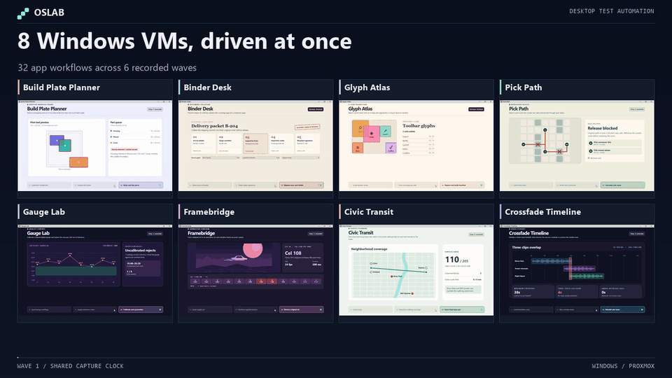
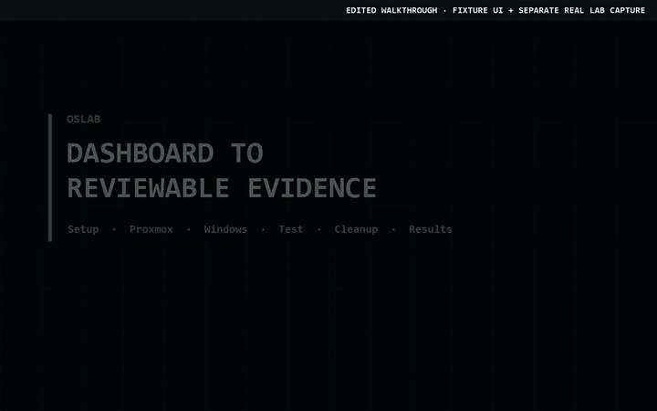

# OSLAB

<div align="center">
  
  <h3>실제 Windows 환경을 일회용 VM으로 반복 검증하세요</h3>
  <p>하나의 YAML 시나리오를 깨끗한 VM 실행, 재현 가능한 판정, 검토 가능한 증거로 연결합니다.</p>
</div>

<p align="center">
  <a href="README.md">English</a> · 한국어
</p>



> **Windows 11에서 앱 32개 검증.** OSLab MCP로 각각의 VM에서 오프라인 예제 앱 28개와 Windows 기본 앱 4개를 조작해 검증 항목 351개를 통과했습니다. 첫 장면은 동시에 촬영한 여덟 대를 보여 주고, 전체 32칸에는 여섯 배치의 화면을 모았습니다.

[1080p MP4 다운로드](https://raw.githubusercontent.com/hostkimjang/OSLAB/master/docs/media/oslab-windows-app-matrix.mp4) · [32개 시나리오 실행 방법](docs/windows-app-matrix.ko.md) · [VM 검증 결과](docs/media/oslab-windows-app-matrix-attestation.json)

[Dispatch Board MSI 설치·업그레이드 예제](docs/release-qa-demo.ko.md) · [Dispatch Board 영상](https://raw.githubusercontent.com/hostkimjang/OSLAB/master/docs/media/oslab-release-qa.mp4)

OSLAB은 단위 테스트나 컨테이너, 모의 환경만으로 확인하기 어려운 소프트웨어를 **실제 운영체제에서 검증하는 OS 통합 테스트 플랫폼**입니다. 일회용 VM을 복제하고, 게스트 환경을 준비한 뒤, 테스트할 파일을 전송해 실행합니다. 이어서 결과 판정과 보고서 생성을 마치고 VM을 정리합니다.

현재 처음부터 끝까지 연결된 경로는 **Proxmox 위의 Windows와 QEMU Guest Agent(QGA)** 조합입니다. Linux 시나리오와 SSH/WinRM 개념은 모델에 포함되어 있지만 해당 실행 경로는 아직 완성되지 않았습니다. Proxmox 이외의 VM 공급자도 향후 작업 범위입니다.

## OSLAB이 필요한 이유

소프트웨어의 실제 동작은 소스 코드만으로 결정되지 않습니다. OS 패치 수준, 런타임, 정책, 레지스트리, 설치된 프로그램, 사용자 권한, 이전 설정에 따라 결과가 달라질 수 있습니다. OSLAB은 이런 조건을 한 번 정의한 뒤 깨끗한 VM에서 같은 검증을 반복할 수 있게 합니다.

- 제품별 스크립트에서 VM 생성·삭제 로직을 분리합니다.
- 공통 환경 준비와 테스트 대상을 명확히 나눕니다.
- 서로 다른 원시 출력을 공통 형식으로 정리한 뒤 합격 여부를 판단합니다.
- 로그, 원본 데이터, 정규화 데이터, 보고서를 함께 남겨 원인 분석을 돕습니다.
- 같은 시나리오를 CLI와 로컬 웹 대시보드에서 실행합니다.

## 자동화 범위

```text
시나리오 YAML
  → 일회용 VM 복제 및 부팅
  → 게스트 통신 준비 대기
  → fixture로 환경 준비
  → artifact 업로드 및 실행
  → 결과 수집 및 정규화
  → assertion 평가
  → JSON · JUnit · HTML 증거 생성
  → VM 정리
```

시나리오는 다음 책임을 서로 섞이지 않게 유지합니다.

| 구성 | 맡는 일 |
| --- | --- |
| Provider | VM 복제, 시작, 정지, 삭제 |
| Guest channel | 게스트 안에서 명령 실행과 파일 전송 |
| Fixture | 공통 OS 상태와 선행 조건 준비 |
| Artifact + assertions | 테스트 대상 실행과 합격·실패 판정 |

### 영상으로 보는 OSLAB 전체 실행 흐름

[](docs/media/oslab-step-by-step-demo.mp4)

> 대시보드에서 시나리오와 실행 옵션을 설정하는 과정부터 10단계 오케스트레이션, 실제 Proxmox·Windows 동작, 일회용 VM 정리, Results Explorer의 결과 확인까지 순서대로 보여 줍니다. 미리보기를 누르면 전체 영상을 재생할 수 있습니다.

> **영상 구성 안내:** 대시보드·오케스트레이션·결과 화면은 고정된 데모 데이터(fixture)로 재현했고, Proxmox·Windows 구간은 실제 랩에서 별도로 촬영했습니다. 전체 흐름을 이해하기 쉽도록 편집한 영상이므로 하나의 실행을 연속 녹화한 것은 아닙니다. 마지막 결과 화면도 실제 랩 촬영분의 결과 레코드가 아니라 OSLAB의 결과 표시 방식을 보여 주는 예시입니다.

[통합 영상 구간·해시 검증](docs/media/oslab-step-by-step-demo-attestation.json) · [실제 랩 캡처 검증](docs/media/oslab-live-lab-attestation.json)

## 웹 대시보드

로컬 대시보드에서는 다음 작업을 할 수 있습니다.

- 랩 준비 상태와 VM 상태 확인
- 시나리오, fixture, suite 작성
- artifact 탐색과 스크립트 작성 보조
- 단일 시나리오와 suite 실행
- 실시간 작업 로그 확인
- 결과 타임라인, 증거 누락 여부, 보고서 미리 보기

## 실행 흐름


VM 정리도 실행 계약의 일부입니다. 실패한 VM을 디버깅 목적으로 남기도록 설정할 수 있지만, 공개 데모는 기본적으로 복제한 VM을 삭제하도록 구성되어 있습니다.

## 현재 지원 범위

| 영역 | 상태 |
| --- | --- |
| Proxmox VM 수명 주기 | 구현됨 |
| Windows + QEMU Guest Agent | 전체 실행 경로 구현됨 |
| 폴더 및 설치 파일 artifact | 구현됨 |
| PowerShell fixture | 구현됨 |
| JSON, JUnit XML, HTML, 구조화 진행 로그 | 구현됨 |
| 로컬 웹 대시보드 | 구현됨 |
| Linux + SSH 실행 | 미완성 |
| WinRM 실행 | 미완성, 현재 QGA 경로에는 필요 없음 |
| Proxmox 이외의 provider | 미완성 |

## VM 없이 빠르게 확인하기

아래 명령은 Python 환경과 공개 시나리오 형식을 확인합니다. **VM을 만들지 않습니다.**

준비물은 [Python 3.11 이상](https://www.python.org/)과 [uv](https://docs.astral.sh/uv/)입니다.

```powershell
uv sync
uv run oslab --help
uv run oslab validate-scenario --scenario scenarios/windows/demo-powershell-system.example.yaml
```

예제 시나리오에는 구체적인 데모 template과 VMID 값이 들어 있습니다. 그대로 사용하지 말고 파일을 복사한 뒤, 실제 랩의 수명 주기 관련 값을 모두 확인해서 수정하세요.

## 대시보드 시작하기

Node.js, Corepack, 위의 Python 환경이 필요합니다.

```powershell
corepack pnpm install
Copy-Item apps/api/.env.example apps/api/.env
Copy-Item apps/web/.env.example apps/web/.env
corepack pnpm prisma:generate
corepack pnpm prisma:migrate
corepack pnpm dev
```

실행하기 전에 `apps/api/.env`의 `OSLAB_REPO_ROOT`를 이 저장소의 절대 경로로 바꾸고, 예시 대시보드 암호도 반드시 교체하세요. 기본 주소는 웹 `http://localhost:3000`, API `http://localhost:3001`입니다.

대시보드는 VM을 만들고 삭제하는 명령을 실행할 수 있습니다. 인증, 네트워크 공개 범위, 접근 제어를 의도적으로 구성한 경우가 아니라면 localhost 바인딩을 유지하세요. 자세한 내용은 [웹 대시보드](docs/web-dashboard.ko.md)와 [대시보드 서버](docs/web-dashboard-server.ko.md)를 참고하세요.

## 실제 VM에서 실행하기

실제 실행에는 다음 준비가 필요합니다.

1. 접속 가능한 Proxmox 클러스터와 API 토큰
2. QEMU Guest Agent가 설치되고 활성화된 Windows template
3. 일회용 VM을 위한 안전한 VMID 범위
4. 버전 관리에서 제외한 로컬 설정과 비밀 값
5. 실제 template과 VMID를 반영한 시나리오 사본

전체 준비 과정은 [시작하기](docs/getting-started.ko.md)를 따라가세요. 첫 실제 실행에는 추가 런타임 의존성이 적은 PowerShell 데모가 적합합니다.

```powershell
uv run oslab preflight `
  --scenario scenarios/windows/demo-powershell-system.local.yaml `
  --config config/oslab.local.yaml `
  --env-file config/oslab.local.env

uv run oslab run `
  --scenario scenarios/windows/demo-powershell-system.local.yaml `
  --artifact-path validation/artifacts/powershell-system `
  --config config/oslab.local.yaml `
  --env-file config/oslab.local.env
```

공용 클러스터에서 예제 시나리오를 그대로 실행하지 마세요. template, VMID 범위, 정리 정책, 게스트 내부 경로, artifact 실행 명령을 먼저 검토해야 합니다.

<a id="codex-mcp"></a>
## Codex 또는 Claude로 테스트 VM 조작하기

그래픽 콘솔이 있는 테스트 VM을 켜고 VMID를 확인합니다. Windows 앱을 조작하려면 데스크톱에 로그인합니다. VM에 Computer Use 프로그램을 별도로 설치할 필요는 없습니다. 위 예제로 테스트 VM을 복제·부팅하고 나서 연결하려면 `oslab run`에 `--keep-vm`을 추가합니다. OSLab의 Proxmox 토큰에는 해당 VM을 조회할 권한과 `VM.Console` 권한이 필요합니다. 저장소 루트에서 실행합니다.

```powershell
$vmId = Read-Host '테스트 VM의 VMID'
codex mcp add oslab -- uv --directory (Get-Location).Path run --locked --extra computer-use oslab-mcp `
  --config config/oslab.local.yaml --env-file config/oslab.local.env --vm-id $vmId
codex mcp get oslab
```

`codex mcp get oslab`에서 등록한 VMID를 확인합니다. 여러 VM을 조작할 때는 등록 명령에 VM마다 `--vm-id`를 추가합니다. Codex에 `oslab` 도구가 보이면 VM 콘솔 창을 닫고 다음과 같이 요청합니다.

> OSLab MCP의 `list_vms`로 내 테스트 VM을 확인하고 화면을 캡처해 줘. `Win+r`을 누른 뒤 `notepad`를 한 글자씩 입력하고 Enter를 눌러 메모장을 열어 줘. 새 캡처를 보고 메모장 편집 영역을 클릭해 `oslab mcp ok`를 입력한 다음, 문구가 보이는 최종 화면을 PNG로 캡처해 보여 줘.

Claude Code에서도 같은 서버를 모든 프로젝트에서 사용할 수 있습니다. [Claude Code 사용자 범위 등록](docs/computer-use-mcp.ko.md#claude-code) 또는 [Claude Desktop 설정](docs/computer-use-mcp.ko.md#claude-desktop)을 따릅니다.

MCP 서버는 Proxmox API로 콘솔 티켓을 받고 VNC WebSocket으로 해당 VM의 화면과 입력을 주고받습니다. 작업 중에도 호스트에서 마우스와 키보드를 사용할 수 있습니다. [구현 방식과 도구 사용법](docs/computer-use-mcp.ko.md)

[VM 두 대의 입력 격리 검증 영상](https://raw.githubusercontent.com/hostkimjang/OSLAB/master/docs/media/oslab-computer-use-demo.mp4) · [검증 기록](docs/media/oslab-computer-use-demo-attestation.json)

## 실행 증거와 보고서

각 실행 결과는 `runs/<run-id>/`에 저장됩니다. 시나리오에 따라 파일 구성은 달라지지만 기본 구조는 다음과 같습니다.

```text
runs/<run-id>/
├─ run.json
├─ logs/
│  └─ progress.jsonl
├─ raw/
├─ normalized/
└─ reports/
   ├─ result.json
   ├─ result.junit.xml
   └─ result.html
```

- 실행 상태와 파일 목록은 `run.json`에서 먼저 확인합니다.
- provider, guest, 명령 실행 실패는 `logs/`와 `raw/`에서 추적합니다.
- 실제 판정에 사용된 데이터는 `normalized/`에서 확인합니다.
- CI에는 JUnit을 연결하고, 사람이 검토할 때는 HTML 보고서를 엽니다.

전체 결과 계약은 [보고서와 증거](docs/reports.ko.md)에 정리되어 있습니다.

## 공개 데모

Windows 예제에는 PowerShell 시스템 정보, Python과 C 프로그램, fixture 상태, 단계별 명령, 단위 테스트 출력, HTTP 서비스, 의도적인 assertion 실패가 포함되어 있습니다. [데모 목록](docs/demos.ko.md)에서 시작한 뒤, 자신의 소프트웨어로 바꿀 때는 [도입 가이드](docs/adoption-guide.ko.md)를 참고하세요.

Linux 예제는 앞으로 지원할 시나리오 형식을 보여 주기 위한 것입니다. 아직 처음부터 끝까지 실행되는 Linux 경로는 아닙니다.

## 문서 안내

| 목적 | 문서 |
| --- | --- |
| 설치하고 첫 데모 실행 | [시작하기](docs/getting-started.ko.md) |
| 핵심 모델 이해 | [핵심 개념](docs/concepts.ko.md) |
| 예제 선택 | [데모 목록](docs/demos.ko.md) |
| Proxmox 랩 연결 | [Proxmox 연결](docs/proxmox-connection.ko.md) |
| Codex·Claude로 VM 화면 캡처·조작 | [Codex 등록과 메모장 데모](#codex-mcp), [MCP 가이드](docs/computer-use-mcp.ko.md) |
| 시나리오 YAML 작성 | [시나리오](docs/scenarios.ko.md) |
| 게스트 상태 준비 | [Fixture](docs/fixtures.ko.md) |
| Assertion과 JUnit 이해 | [검증](docs/validation.ko.md) |
| 실행 증거 읽기 | [보고서](docs/reports.ko.md) |
| 다른 제품에 OSLAB 도입 | [도입 가이드](docs/adoption-guide.ko.md) |
| 로컬 UI 실행 | [웹 대시보드](docs/web-dashboard.ko.md) |
| 구조와 방향 검토 | [플랫폼 계획](docs/oslab-platform-plan.ko.md) |

## 보안 경계

- Proxmox 토큰, VM 암호, 비공개 artifact 경로, 실제 장비 식별자를 커밋하지 마세요.
- `config/oslab.local.yaml`, `config/oslab.local.env`, 대시보드 `.env`, `runs/`, 업로드한 artifact는 로컬에만 둡니다.
- 가능한 한 권한이 작은 전용 Proxmox 토큰과 OSLAB 전용 VMID 범위를 사용하세요.
- 시나리오와 fixture의 명령은 코드와 같습니다. 실행 전에 반드시 검토하세요.
- 대시보드 접근 권한은 랩 관리 권한과 같은 수준으로 다루세요.

포크나 공개 후보를 배포하기 전에는 [GitHub 공개 체크리스트](docs/github-release-checklist.ko.md)를 확인하세요.

## 개발

```powershell
# Python
uv run pytest

# 대시보드
corepack pnpm lint
corepack pnpm test
corepack pnpm build
```

수정한 영역에 맞는 검사를 실행하세요. 현재 저장소에는 CI 상태 배지가 없으므로, 위 명령 목록 자체가 모든 checkout의 테스트 통과를 보장하지는 않습니다.

## 라이선스

현재 저장소에는 `LICENSE` 파일이 없습니다. 라이선스가 추가되기 전까지는 복사, 수정, 재배포 권한이 있다고 가정하지 마세요.
