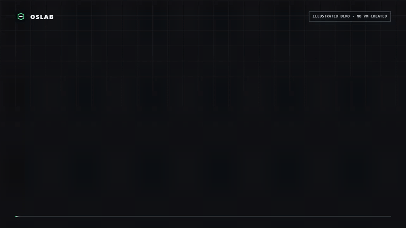
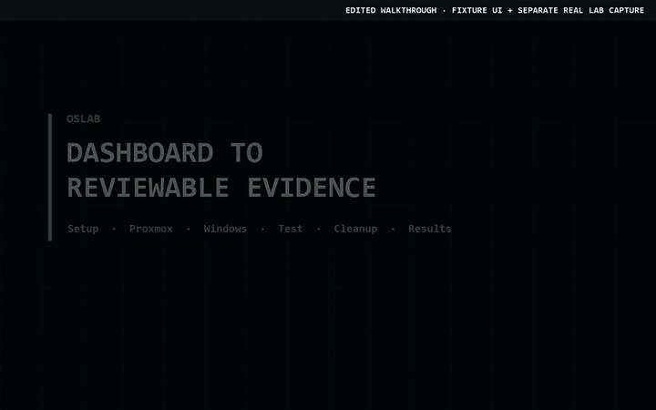

# OSLAB

<div align="center">
  
  <h3>Disposable VM testing for real Windows environments</h3>
  <p>Turn one YAML scenario into a clean VM run, repeatable assertions, and evidence your team can review.</p>
</div>

<p align="center">
  English · <a href="README.ko.md">한국어</a>
</p>

[](docs/media/oslab-overview.mp4)

> The animation is an illustrated overview. Select it to open the higher-quality MP4.

OSLAB is an OS integration test platform for software that must be verified in a real operating system—not only in a unit test, container, or mocked environment. It clones a disposable VM, prepares the guest, transfers an artifact, executes it, evaluates assertions, writes reports, and cleans up the VM.

The complete path available today is **Windows on Proxmox through QEMU Guest Agent (QGA)**. Linux scenarios and SSH/WinRM concepts exist in the model, but those execution paths are not complete. Additional VM providers are also future work.

## Why OSLAB

OS behavior depends on more than source code. Patch levels, runtimes, policies, registry state, installed software, user context, and prior configuration can all change a result. OSLAB lets a team describe those conditions once and repeat the same validation on disposable machines.

- Keep VM lifecycle work out of product-specific scripts.
- Separate guest preparation from the artifact under test.
- Normalize raw command output before evaluating assertions.
- Preserve logs, raw data, normalized data, and reports for diagnosis.
- Use the same scenario from the CLI or the local web dashboard.

## What It Automates

```text
scenario YAML
  → clone and boot an ephemeral VM
  → wait for the guest channel
  → apply fixtures
  → upload and run the artifact
  → collect and normalize output
  → evaluate assertions
  → write JSON, JUnit, and HTML evidence
  → destroy the VM
```

Scenarios keep four responsibilities distinct:

| Part | Responsibility |
| --- | --- |
| Provider | Clone, start, stop, and destroy the VM |
| Guest channel | Execute commands and transfer files inside the guest |
| Fixture | Prepare shared OS state and prerequisites |
| Artifact + assertions | Run the software under test and decide pass or fail |

### Watch the complete OSLAB workflow

[](docs/media/oslab-step-by-step-demo.mp4)

> Follow the flow from configuring a scenario and launch options in the Dashboard through ten-step orchestration, real Proxmox and Windows activity, disposable-VM cleanup, and final review in Results Explorer. Select the preview to play the full video.

> **About the footage:** The Dashboard, orchestration, and result screens use fixed fixture data; the Proxmox and Windows segments were captured separately in a real lab. This edited walkthrough is not one continuous run, and its final result screen demonstrates OSLAB's evidence UI rather than the result record from the live capture.

[Composite segments and hash attestation](docs/media/oslab-step-by-step-demo-attestation.json) · [Live lab capture attestation](docs/media/oslab-live-lab-attestation.json)

## Web Dashboard

The local dashboard provides:

- lab readiness and VM status;
- scenario, fixture, and suite authoring;
- artifact browsing and script assistance;
- single-scenario and suite launchers;
- live job output;
- result timelines, evidence checks, and report previews.

## Lifecycle

```mermaid
flowchart LR
    A[Scenario YAML] --> B[Validate and preflight]
    B --> C[Clone disposable VM]
    C --> D[Wait for QGA]
    D --> E[Apply fixtures]
    E --> F[Upload artifact]
    F --> G[Execute and collect]
    G --> H[Normalize and assert]
    H --> I[JSON · JUnit · HTML]
    I --> J[Cleanup VM]
```



Cleanup is part of the run contract. A scenario can retain a failed VM for debugging, but the default public demos are designed to destroy their clones.

## Current Scope

| Area | Status |
| --- | --- |
| Proxmox VM lifecycle | Implemented |
| Windows + QEMU Guest Agent | Complete end-to-end path |
| Folder and installer artifacts | Implemented |
| PowerShell fixtures | Implemented |
| JSON, JUnit XML, HTML, structured progress | Implemented |
| Local web dashboard | Implemented |
| Linux + SSH execution | Incomplete |
| WinRM execution | Incomplete; not required by the QGA path |
| Providers other than Proxmox | Incomplete |

## Quick Local Check

This verifies the Python environment and parses a public scenario. It does **not** create a VM.

Prerequisites: [Python 3.11+](https://www.python.org/) and [uv](https://docs.astral.sh/uv/).

```powershell
uv sync
uv run oslab --help
uv run oslab validate-scenario --scenario scenarios/windows/demo-powershell-system.example.yaml
```

The example scenario contains concrete demo template and VMID values. Treat them as examples: copy the file and verify every lifecycle value against your own lab before running it.

## Start the Dashboard

Prerequisites: Node.js, Corepack, and the Python setup above.

```powershell
corepack pnpm install
Copy-Item apps/api/.env.example apps/api/.env
Copy-Item apps/web/.env.example apps/web/.env
corepack pnpm prisma:generate
corepack pnpm prisma:migrate
corepack pnpm dev
```

Before starting, set `OSLAB_REPO_ROOT` in `apps/api/.env` to this repository's absolute path and replace the example dashboard password. Then open `http://localhost:3000`; the API listens on `http://localhost:3001` by default.

The dashboard can launch commands that create and destroy VMs. Keep it bound to localhost unless you have deliberately configured authentication, network exposure, and access controls. See [Web Dashboard](docs/web-dashboard.md) and [Dashboard Server](docs/web-dashboard-server.md).

## Run on a Real VM

A real run requires:

1. a reachable Proxmox cluster and API token;
2. a Windows template with QEMU Guest Agent installed and enabled;
3. a safe VMID range for disposable clones;
4. local config and secrets kept outside version control;
5. a local copy of a scenario with the correct template and VMID values.

Follow the [Getting Started guide](docs/getting-started.md) for the full setup, then use the low-dependency PowerShell demo as the first real run:

```powershell
uv run oslab preflight `
  --scenario scenarios/windows/demo-powershell-system.local.yaml `
  --config config/oslab.local.yaml `
  --env-file config/oslab.local.env

uv run oslab run `
  --scenario scenarios/windows/demo-powershell-system.local.yaml `
  --artifact-path validation/artifacts/powershell-system `
  --config config/oslab.local.yaml `
  --env-file config/oslab.local.env
```

Do not run an example scenario unchanged against a shared cluster. Review the template, VMID range, cleanup policy, guest destinations, and artifact command first.

<a id="codex-mcp"></a>
## Control a Test VM with Codex

Start a test VM with a graphical console and note its VMID. Sign in to the Windows desktop to control apps. The VM needs no separate computer-use software. To keep the clone from the example above running, add `--keep-vm` to `oslab run`. Your OSLab Proxmox token needs permission to see the VM and the `VM.Console` privilege. Run these commands from the repository root.

```powershell
$vmId = Read-Host 'Test VMID'
codex mcp add oslab -- uv --directory (Get-Location).Path run --locked --extra computer-use oslab-mcp `
  --config config/oslab.local.yaml --env-file config/oslab.local.env --vm-id $vmId
codex mcp get oslab
```

Check the registered VMID in `codex mcp get oslab`. To control more than one VM, repeat `--vm-id` in the registration command. Once Codex shows the `oslab` tools, close the VM console window and try this prompt.

> Use the OSLab MCP to list the test VM and capture its screen. Press `Win+r`, enter `notepad` one key at a time, and press Enter. Capture the new screen, click the Notepad editing area, and type `oslab mcp ok`. Show me the final PNG with the text visible.

The MCP server gets a console ticket from the Proxmox API and exchanges screen data and input over a VNC WebSocket. The host mouse and keyboard remain available while Codex works. [Implementation and tools](docs/computer-use-mcp.md)

## Evidence and Reports

Each run writes to `runs/<run-id>/`. The exact files depend on the scenario, but the common layout is:

```text
runs/<run-id>/
├─ run.json
├─ logs/
│  └─ progress.jsonl
├─ raw/
├─ normalized/
└─ reports/
   ├─ result.json
   ├─ result.junit.xml
   └─ result.html
```

- Start with `run.json` for the run status and file index.
- Use `logs/` and `raw/` to diagnose provider, guest, or command failures.
- Use `normalized/` to inspect the data evaluated by assertions.
- Publish JUnit to CI and open the HTML report for a human-readable result.

See [Reports and Evidence](docs/reports.md) for the complete contract.

## Public Demo Catalog

The repository includes Windows examples for PowerShell system inspection, Python and C programs, fixture state, step-based commands, unit-test output, an HTTP service, and intentional assertion failure. Start with [Demo Catalog](docs/demos.md); use [Adoption Guide](docs/adoption-guide.md) when replacing a demo artifact with your own software.

The Linux example documents the intended scenario shape. It is not an end-to-end supported Linux run yet.

## Documentation

| Goal | Document |
| --- | --- |
| Install and run the first demo | [Getting Started](docs/getting-started.md) |
| Understand the model | [Concepts](docs/concepts.md) |
| Choose an example | [Demo Catalog](docs/demos.md) |
| Connect a Proxmox lab | [Proxmox Connection](docs/proxmox-connection.md) |
| Control a VM screen with Codex | [Codex setup and Notepad demo](#codex-mcp), [MCP guide](docs/computer-use-mcp.md) |
| Write scenario YAML | [Scenarios](docs/scenarios.md) |
| Prepare guest state | [Fixtures](docs/fixtures.md) |
| Understand assertions and JUnit | [Validation](docs/validation.md) |
| Read run evidence | [Reports](docs/reports.md) |
| Adopt OSLAB for another product | [Adoption Guide](docs/adoption-guide.md) |
| Run the local UI | [Web Dashboard](docs/web-dashboard.md) |
| Review the architecture | [Platform Plan](docs/oslab-platform-plan.md) |

## Security Boundaries

- Never commit Proxmox tokens, VM passwords, private artifact paths, or real lab identifiers.
- Keep `config/oslab.local.yaml`, `config/oslab.local.env`, dashboard `.env` files, `runs/`, and uploaded artifacts local.
- Use a dedicated Proxmox token with the smallest practical permissions and a VMID range reserved for OSLAB.
- Treat scenario and fixture commands as code: review them before execution.
- Treat dashboard access as privileged lab access.

Before publishing a fork or a release candidate, follow the [Public GitHub Release Checklist](docs/github-release-checklist.md).

## Development

```powershell
# Python
uv run pytest

# Dashboard
corepack pnpm lint
corepack pnpm test
corepack pnpm build
```

Run the checks relevant to the area you changed. The repository does not currently publish a CI status badge, so do not interpret the commands above as a claim that every checkout is green.

## License

This repository does not currently include a `LICENSE` file. Do not assume permission to copy, modify, or redistribute the project until a license is added.
