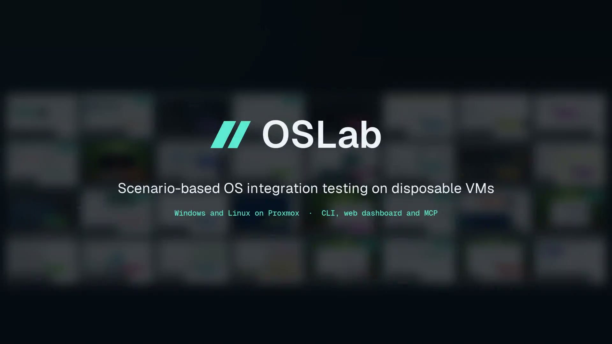

# OSLab 소개 영상

[English](intro-video.md) · 한국어

[](https://raw.githubusercontent.com/hostkimjang/OSLAB/master/docs/media/oslab-intro-film.mp4)

[1080p MP4 다운로드](https://raw.githubusercontent.com/hostkimjang/OSLAB/master/docs/media/oslab-intro-film.mp4) · [검증 기록](media/oslab-intro-film-attestation.json) · [제작 방법](#제작-방법)

## 시놉시스

Windows 11 VM 32대의 화면으로 시작해, Windows 11과 Ubuntu 24.04에서 같은 후보 빌드를 새로 설치하거나 이전 버전에서 올리는 과정을 따라갑니다. 테스트 대상은 인벤토리 에이전트 예제인 Demo Agent입니다. [영상에 나온 환경 매트릭스 실행하기](user-scenario.ko.md)

`oslab suite-run` 한 번으로 일회용 VM 네 대를 실행합니다. Windows 새 설치 장면에는 로그인한 바탕 화면에서 실행되는 에이전트 명령이 나옵니다. Ubuntu 업그레이드 장면에서는 2.3.1에서 2.4.0으로 올리는 과정과 기존 자산 ID와 설정이 유지됐는지 확인하는 검사를 보여 줍니다. VM을 삭제한 뒤에도 로그, 인벤토리, 보고서는 남습니다.

이어서 로컬 웹 대시보드에서 다른 실행을 시작해 로그를 실시간으로 보고, 끝난 실행의 증거와 보고서를 엽니다. 그다음 Codex가 OSLab MCP 서버와 Proxmox 콘솔을 통해 Windows 데스크톱을 조작합니다. 메모장을 열어 한 줄을 입력하고 바탕 화면에 저장한 뒤 파일 탐색기에서 그 파일을 보여 줍니다. 그동안 호스트의 마우스와 키보드는 그대로 쓸 수 있고, QEMU Guest Agent가 저장된 파일을 확인합니다.

마지막 장은 Windows 프로그램 32개로 돌아갑니다. LibreOffice Calc와 Visual Studio Code의 수정 장면과 에이전트가 VM을 조작하는 경로를 보여 준 뒤, 전체 VM 화면 위에 프로그램 32개와 게스트 검사 140개의 통과 결과를 표시합니다.

## 장 구성

| 장 | 화면 내용 |
| --- | --- |
| 첫 장면 | Windows VM 32대와 OSLab 제목 |
| 01 시나리오 | Demo Agent의 Windows 새 설치 시나리오 |
| 02 실행 | `oslab suite-run`과 로그인한 Windows 데스크톱, 이어서 Windows와 Ubuntu의 네 가지 테스트 화면 |
| 03 증거 | Ubuntu 업그레이드의 실행 파일 목록, HTML 보고서, 검증 결과 |
| 04 대시보드 | 웹 대시보드에서 시작한 별도 실행, 실시간 로그와 결과 |
| 05 AI 에이전트 | Codex가 MCP로 메모장과 파일 탐색기를 조작하고 게스트 검사로 저장된 파일을 확인 |
| 06 다중 VM | Calc와 VS Code 수정 장면, MCP 화면 조작 경로, Windows VM 32대의 최종 결과 |
| 마무리 | OSLab과 저장소 주소 |

## 실제 녹화와 편집

- 02장과 03장은 같은 실행 묶음에서 녹화했습니다. 02장에서는 `windows-fresh`를 먼저 확대하고, 03장에서는 `ubuntu-upgrade`의 결과를 봅니다. 04장과 05장은 기존 대시보드 실행과 별도 VM에서 진행한 Codex 세션을 다시 썼습니다.
- VM 화면은 실행 중 Proxmox 콘솔을 녹화한 것입니다. 보고서와 대시보드는 화면을 띄우지 않는 Chromium으로 녹화했고, 대시보드는 Playwright로 조작했습니다.
- YAML은 화면에서 읽을 수 있게 배치하고, 터미널은 실제 출력을 재생했습니다. 명령을 입력하는 모습은 애니메이션이며 대기 구간은 빠르게 재생했습니다. 수명 주기 막대에는 기록된 단계별 소요 시간을 표시했습니다. 터미널, 보고서, 대시보드의 비공개 이름은 공개용 이름으로 바꿨습니다.
- 편집 과정에서 기록된 입력 위치에 커서를 그리고 위치 사이를 보간했습니다. 05장의 커서는 Codex가 호출한 MCP `move_mouse`와 `click`을 따릅니다. 게스트의 자체 포인터도 녹화 화면에 보입니다.
- 통과 표시는 실행 결과와 게스트 검사를 근거로 합니다. 첫 장면과 피날레의 [32대 Windows QA 화면](#32대-windows-qa-영상)은 최대 8대씩 녹화한 뒤 각 작업의 시작 시점에 맞춰 배치했습니다. 제목과 최종 집계에는 애니메이션을 적용했습니다. MP4는 무음입니다.

## 제작 방법

먼저 랩용 실행 묶음과 시나리오 사본 네 개를 준비합니다. 녹화에는 FFmpeg, 저장소의 Playwright 의존성을 설치한 Node.js, Proxmox 노드의 LAN API 접속이 필요합니다. [실행 묶음 준비하기](user-scenario.ko.md#매트릭스-실행하기)

1. `capture_suite.py`가 `uv run --locked oslab suite-run`을 실행합니다. 터미널 출력 시각과 VM 콘솔 네 개를 녹화하고, `suite.json`과 각 실행의 증거를 저장합니다. `--report-entry ubuntu-upgrade`로 03장에 쓸 HTML 보고서도 녹화합니다. `--chromium`으로 설치된 Chromium 실행 파일을 지정할 수 있습니다. 보고서만 다시 녹화할 때는 `--evidence-only --run-id <같은-실행-ID>`를 사용합니다.
2. `capture_dashboard.mjs`가 API 포트, SQLite 데이터베이스, 웹 빌드를 따로 쓰는 대시보드를 띄웁니다. 실행 화면, 실시간 콘솔, 결과 화면을 녹화하고 포인터 입력과 시각을 기록합니다. [Windows 단계별 실행 예제](../scenarios/windows/demo-agent-steps.example.yaml)를 `scenarios/windows/qa-demo-agent-steps.example.yaml`로 복사하고 템플릿과 VMID 범위를 랩에 맞춥니다.
3. `capture_agent.py run`이 로그인한 Windows 복제본의 콘솔을 녹화하는 동안 MCP 클라이언트가 VM을 조작하고 `calls.json`에 호출 기록을 남깁니다. 클라이언트가 파일을 저장한 뒤 두 번째 터미널에서 `capture_agent.py check`로 확인하고 중지 파일을 쓰면 녹화가 끝납니다.
4. `edit_intro.py`가 `suite`, `dashboard`, `agent` 캡처 폴더와 32대 QA 영상의 원본을 읽어 1920×1080, 30fps MP4를 만듭니다. `--preview`로 원하는 프레임을 확인하고 `--receipt`로 인코딩한 사본의 검증 기록을 씁니다. [32대 VM 영상 재현하기](windows-product-qa.ko.md#32대-영상-녹화)

```powershell
$demo = 'validation/artifacts/intro-video'
$capture = "$env:TEMP/oslab-intro"
$lan = Read-Host 'Proxmox API LAN 주소'
uv run --locked --extra computer-use python "$demo/capture_suite.py" --output "$capture/suite" `
    --suite validation/suites/qa-demo-agent-matrix.example.yaml --artifact-path validation/artifacts/demo-agent-cli `
    --config config/oslab.local.yaml --env-file config/oslab.local.env --lan-address $lan `
    --max-parallel 4 --report-entry ubuntu-upgrade --ffmpeg ffmpeg
node "$demo/capture_dashboard.mjs" --out "$capture/dashboard" --scenario scenarios/windows/qa-demo-agent-steps.example.yaml `
    --artifact validation/artifacts/demo-agent-cli --ffmpeg ffmpeg
$agent = @('--config', 'config/oslab.local.yaml', '--env-file', 'config/oslab.local.env', '--work', "$env:TEMP/oslab-agent-capture",
    '--output', "$capture/agent", '--template-vmid', '9200', '--vmid-start', '9185', '--vmid-end', '9189', '--lan-address', $lan)
uv run --locked --extra computer-use python "$demo/capture_agent.py" run @agent
# 동일한 변수를 설정한 두 번째 터미널에서 calls.json이 생긴 뒤 실행합니다.
uv run --locked --extra computer-use python "$demo/capture_agent.py" check @agent
New-Item -ItemType File "$env:TEMP/oslab-agent-capture/stop.flag"
$edit = @('--captures', $capture, '--fleet', 'runs/windows-product-qa-demo', '--fonts', 'fonts/geist', '--out', "$capture/edit", '--ffmpeg', 'ffmpeg')
uv run --locked --extra computer-use python "$demo/edit_intro.py" @edit
```

MCP 세션을 녹화하기 전에 예제 명령의 템플릿과 VMID 범위를 랩에 맞게 바꿉니다. 용량이 작은 H.264 사본을 만들려면 영상 길이와 목표 파일 크기에 맞춰 비트레이트를 조정합니다. 아래 예제는 FFmpeg 인코딩 로그를 캡처 폴더에 둡니다.

```powershell
$encode = @('-y', '-i', "$capture/edit/oslab-intro-film.mp4", '-an', '-c:v', 'libx264', '-preset', 'medium',
    '-b:v', '404k', '-maxrate', '1100k', '-bufsize', '2200k', '-pix_fmt', 'yuv420p', '-x264-params', 'aq-mode=3',
    '-passlogfile', "$capture/edit/intro-encode")
ffmpeg @encode -pass 1 -f mp4 NUL
ffmpeg @encode -pass 2 -movflags +faststart docs/media/oslab-intro-film.mp4
uv run --locked --extra computer-use python "$demo/edit_intro.py" @edit --receipt docs/media/oslab-intro-film.mp4
```

## 검증 기록

검증 기록에서 영상에 나온 랩 실행, 녹화 시간, Codex의 MCP 호출, VM 32대의 게스트 검사 결과와 공개 MP4의 SHA-256을 확인할 수 있습니다. [검증 기록](media/oslab-intro-film-attestation.json)

## 32대 Windows QA 영상

https://github.com/user-attachments/assets/52e5a594-a439-44a6-b461-f3e94d1c1c04

[1080p MP4 다운로드](https://raw.githubusercontent.com/hostkimjang/OSLAB/master/docs/media/oslab-windows-product-qa.mp4) · [검증 기록](media/oslab-windows-product-qa-attestation.json) · [재현 방법](windows-product-qa.ko.md#32대-영상-녹화)

이전에 만든 65초 영상은 06장 내용을 자세히 보여 줍니다. 일회용 Windows 11 VM 32대가 저마다 다른 실제 프로그램으로 릴리스 QA를 수행합니다. VM마다 QA 스크립트로 만든 테스트 에이전트가 MCP 도구 `screenshot`, `click`, `move_mouse`, `press_key`로 OSLab MCP 서버를 통해 화면을 조작하고, OSLab은 모든 결과를 게스트 안에서 확인합니다. 카메라는 LibreOffice Calc, OBS Studio, Visual Studio Code, 7-Zip을 차례로 확대하고, 도식으로 MCP 클라이언트에서 Proxmox 콘솔을 거쳐 게스트 검사까지 이어지는 경로를 보여 준 뒤, 프로그램 32개 통과와 검사 140개 확인으로 끝납니다.

모든 칸은 해당 VM을 끊김 없이 녹화한 콘솔 화면입니다. VM은 최대 8대씩 묶어 실행했고, 전체 화면은 녹화본마다 해당 작업의 시작 시점에 맞춰 배치했습니다. 실패한 시도는 다음 묶음에서 다시 실행했습니다. 첫 전체 화면은 8배속, 마지막 전체 화면은 약 10배속으로 재생하고, 에이전트 커서는 작업 기록에 남은 MCP 입력값으로 편집기가 그립니다. 이 영상은 `edit_video.py`가 만들고, 명령은 [32대 영상 녹화](windows-product-qa.ko.md#32대-영상-녹화)에 있습니다.
