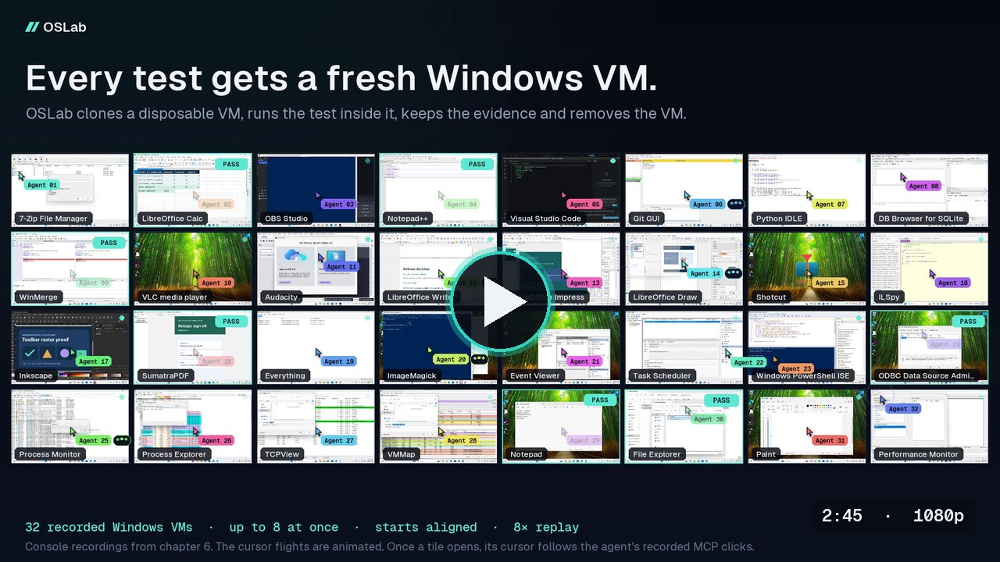

# OSLab introduction video

English · [한국어](intro-video.ko.md)

[](https://raw.githubusercontent.com/hostkimjang/OSLAB/master/docs/media/oslab-intro-film.mp4)

[Download the 1080p MP4](https://raw.githubusercontent.com/hostkimjang/OSLAB/master/docs/media/oslab-intro-film.mp4) · [Verification record](media/oslab-intro-film-attestation.json) · [How the video is made](#how-the-video-is-made)

## Synopsis

The video follows OSLab from a test definition to the evidence it keeps, in 2 minutes 45 seconds. It opens on 32 disposable Windows 11 VMs, each running release QA in a different real program, and then follows a single test from start to finish.

A scenario file names the Windows template, the build and its command, the result file to collect and the checks to pass. One `oslab run` clones a VM on Proxmox, reaches the guest through QEMU Guest Agent, uploads and runs the build, checks its output, and destroys the VM. The terminal output plays next to the console of the VM that the run created, and a lifecycle rail shows how long each step took. The run folder keeps the logs, the raw and normalized output, and the JSON, JUnit and HTML reports.

The local web dashboard launches another run, streams its log and opens the result with its evidence and report. Codex then operates a Windows desktop through the OSLab MCP server and the Proxmox console. It opens Notepad, types a line, saves the file to the Desktop and shows it in File Explorer while the host mouse and keyboard stay free, and QEMU Guest Agent confirms the saved file.

The last chapter returns to the 32 programs. LibreOffice Calc and Visual Studio Code each show a finding, the fix and the guest check that proves it, a diagram traces how a test agent reaches each VM, eight more programs follow, and the wall ends with 32 of 32 programs passed and 140 checks verified inside the guests.

## Chapters

| Time | Chapter | On screen |
| --- | --- | --- |
| 0:00–0:07 | Opening | 32 Windows VMs fill the wall, then the title |
| 0:07–0:19 | 01 Scenario | The scenario YAML, first as a whole file and then one section at a time |
| 0:19–0:44 | 02 Run | `oslab run` output next to the console of the VM it created, with the real duration of each step |
| 0:44–0:57 | 03 Evidence | The run folder, the HTML report and the assertion results |
| 0:57–1:23 | 04 Dashboard | A run launched from the web dashboard, its live log, the evidence checklist and the report |
| 1:23–1:54 | 05 AI agents | Codex works in Notepad and File Explorer through the OSLab MCP server, then the guest checks pass |
| 1:54–2:38 | 06 Scale | The 32-VM wall, the Calc and VS Code fixes, how it works, eight more programs and 32 of 32 passed |
| 2:38–2:45 | End card | What OSLab covers and the repository address |

## Recorded and edited parts

- **Separate recordings:** chapters 02 and 03 come from one CLI run, chapter 04 from a separate dashboard run, and chapter 05 from a separate Codex session on its own VM. The opening and chapter 06 reuse the recordings of the [32-VM Windows QA video](#the-32-vm-windows-qa-video).
- **Screens:** the VM consoles are 30 fps recordings taken through the Proxmox console while each run or session happened. The HTML report and the dashboard are headless Chromium recordings, and a Playwright script drove the dashboard.
- **Rendered panels:** the YAML panel is typeset from the scenario file in this repository. The terminal panel replays the recorded CLI output at its recorded times, and the typing of the command is animated.
- **Speed:** waits play faster, and every recorded chapter shows its current playback speed. The lifecycle rail in chapter 02 shows the real step durations.
- **Names:** local host names, user folders and private variable names are replaced in the terminal text, the HTML report and the dashboard. VM IDs and run IDs stay as recorded.
- **Cursors:** the editor draws the cursors at recorded pointer positions and interpolates the movement between them. In chapter 05 the cursor follows Codex's MCP `move_mouse` and `click` calls, and the guest's own pointer also appears in the recording.
- **Verdicts:** the PASS badges come from `run.json`, the assertion results and the guest checks. A failed run or check shows FAIL.
- **32-VM wall:** the VMs ran in waves of up to 8, and the wall lines up each recording at the start of its own workflow. The cursor flights into the empty slots at the start are a title animation. The finished wall is held for 2 seconds.
- **Sound:** the MP4 has no audio track.

## How the video is made

The video is assembled from four kinds of recordings. Each capture script writes a folder that `edit_intro.py` reads, and each removes the VMs, servers and temporary files it created.

1. `capture_cli.py` runs one scenario with `uv run --locked oslab run` and records the terminal output with arrival times. It records the console of the VM that the run creates from boot to removal, copies the run folder, and records the HTML report with `record_page.mjs`. `aliases.json` lists the public names that replace private ones.
2. `capture_dashboard.mjs` starts a separate dashboard from this checkout, with its own API port, SQLite database and web build, so a running dashboard is not affected. It drives headless Chromium through the Run Launcher, the live console and the Results Explorer, and writes the recording, every pointer action and the times of the main steps. The dashboard does not run scenarios whose path contains `.local.`, so the scenario is another gitignored copy, such as `scenarios/windows/qa-*.example.yaml` or a file under `scenarios/<os>/private/`.
3. `capture_agent.py run` creates a linked clone of a Windows template, signs in its desktop and records its console until a stop file appears. Meanwhile an MCP client such as Codex operates the VM with the OSLab MCP tools and keeps a log of its calls in `calls.json`. `capture_agent.py check` reads the saved file through QEMU Guest Agent and writes `checks.json`.
4. `edit_intro.py` reads the three capture folders and the output folder of the 32-VM QA runs, and writes `oslab-intro-film.mp4` at 1920×1080 and 30 fps. `--preview` renders chosen seconds to PNG files first. The final render fails if a capture is missing, and `--receipt` writes the verification record for an encoded copy.

```powershell
$demo = 'validation/artifacts/intro-video'
$capture = "$env:TEMP/oslab-intro"
uv run --locked --extra computer-use python "$demo/capture_cli.py" --output "$capture/cli" `
    --scenario scenarios/windows/demo-powershell-system.local.yaml --artifact-path validation/artifacts/powershell-system `
    --config config/oslab.local.yaml --env-file config/oslab.local.env --lan-address 192.168.0.10 --ffmpeg ffmpeg
node "$demo/capture_dashboard.mjs" --out "$capture/dashboard" --scenario scenarios/windows/qa-demo-agent-steps.example.yaml `
    --artifact validation/artifacts/demo-agent-cli --ffmpeg ffmpeg
$agent = @('--config', 'config/oslab.local.yaml', '--env-file', 'config/oslab.local.env', '--work', "$env:TEMP/oslab-agent-capture",
    '--output', "$capture/agent", '--template-vmid', '9200', '--vmid-start', '9185', '--vmid-end', '9189', '--lan-address', '192.168.0.10')
uv run --locked --extra computer-use python "$demo/capture_agent.py" run @agent
# After the MCP client has finished and written calls.json:
uv run --locked --extra computer-use python "$demo/capture_agent.py" check @agent
New-Item -ItemType File "$env:TEMP/oslab-agent-capture/stop.flag"
$edit = @('--captures', $capture, '--fleet', 'runs/windows-product-qa-demo', '--fonts', 'fonts/geist', '--out', "$capture/edit", '--ffmpeg', 'ffmpeg')
uv run --locked --extra computer-use python "$demo/edit_intro.py" @edit
```

The published copy is a two-pass H.264 encode of the master that stays under the 10 MB video limit for GitHub's free plan, so the same file also works as a README video attachment. `--receipt` writes the verification record next to it. An attachment that is only added to an unsubmitted comment box returns 404 to signed-out visitors, so post the README attachment in a pull request description before linking it.

```powershell
$encode = @('-y', '-i', "$capture/edit/oslab-intro-film.mp4", '-an', '-c:v', 'libx264', '-preset', 'slower',
    '-b:v', '450k', '-maxrate', '1100k', '-bufsize', '2200k', '-pix_fmt', 'yuv420p', '-x264-params', 'aq-mode=3')
ffmpeg @encode -pass 1 -f mp4 NUL
ffmpeg @encode -pass 2 -movflags +faststart docs/media/oslab-intro-film.mp4
uv run --locked --extra computer-use python "$demo/edit_intro.py" @edit --receipt docs/media/oslab-intro-film.mp4
```

## Verification record

[`oslab-intro-film-attestation.json`](media/oslab-intro-film-attestation.json) records the CLI run with its step durations, the dashboard run, the Codex session with its MCP calls and guest checks, the length and frame count of each recording, the counts from the 32-VM QA runs, the edits listed above, and the SHA-256 of the published MP4. VM IDs and lab host names are left out.

## The 32-VM Windows QA video

https://github.com/user-attachments/assets/52e5a594-a439-44a6-b461-f3e94d1c1c04

[Download the 1080p MP4](https://raw.githubusercontent.com/hostkimjang/OSLAB/master/docs/media/oslab-windows-product-qa.mp4) · [Verification record](media/oslab-windows-product-qa-attestation.json) · [Reproduce the runs](windows-product-qa.md#record-the-32-vm-video)

The earlier 65-second video focuses on chapter 06. Thirty-two disposable Windows 11 VMs each run release QA in a different real program, a scripted test agent drives each VM through the OSLab MCP server with the tools `screenshot`, `click`, `move_mouse` and `press_key`, and OSLab checks every result inside the guest. The camera zooms into LibreOffice Calc, OBS Studio, Visual Studio Code and 7-Zip, a diagram traces the path from the MCP client through the Proxmox console to the guest checks, and the wall ends with 32 of 32 programs passed and 140 checks verified.

Every tile is a continuous console recording of its own VM. The VMs ran in waves of up to 8, the wall lines up each recording at the start of its own workflow, and failed attempts ran again in later waves. The opening wall plays at 8× and the final wall at about 10×, and the editor draws the agent cursors from the MCP inputs recorded in each case file. `edit_video.py` builds that video, and [Record the 32-VM video](windows-product-qa.md#record-the-32-vm-video) lists the commands.
