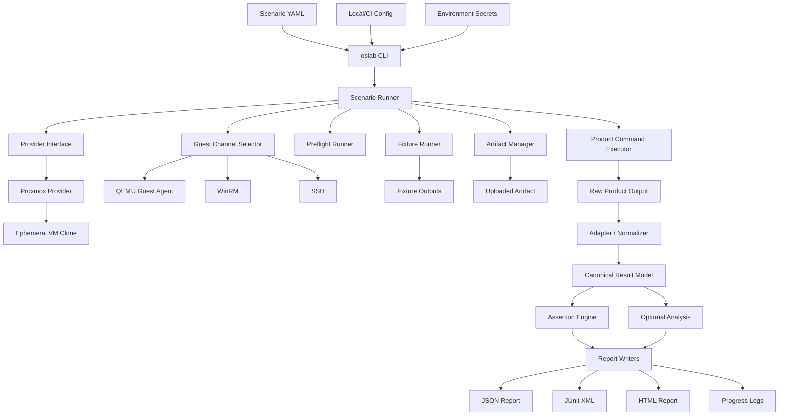
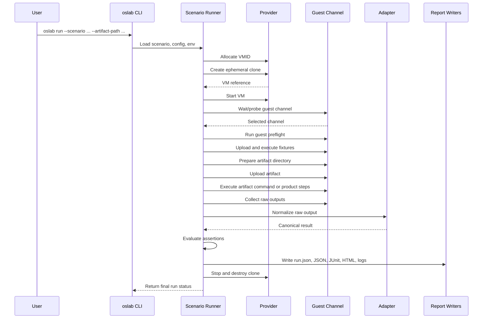
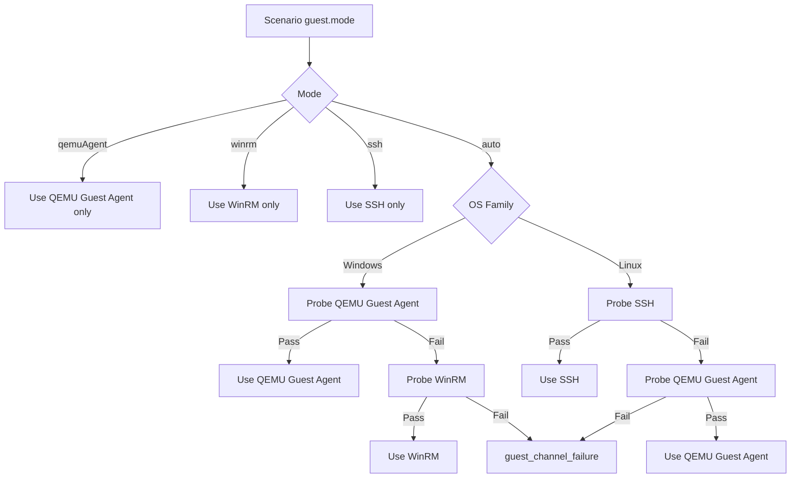
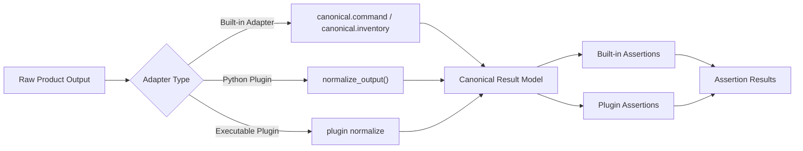
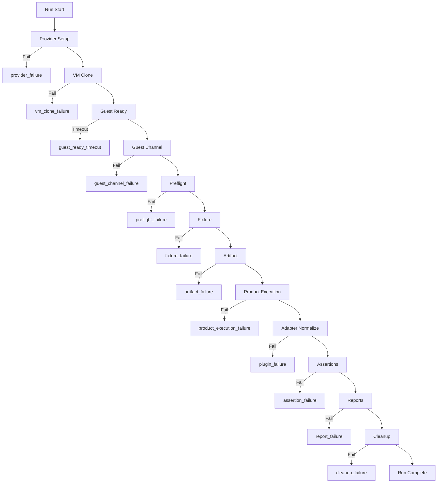

# oslab 플랫폼 계획

언어: [English](oslab-platform-plan.md) | 한국어

## 요약

`oslab은 일회용 Windows 및 Linux VM 안에서 소프트웨어를 검증하기 위한 provider 기반, scenario 기반 OS 통합 테스트 플랫폼입니다.`

`oslab`의 공개 목표는 특정 제품 전용 validation 도구가 아니라, 다양한 OS version, OS setting, runtime state, preinstalled software 조합에서 software artifact를 반복 검증하는 범용 OS/VM integration test platform입니다.

현재 공개 진입점은 Windows Proxmox template에서 실행되는 generic demo suite입니다. 이 demo suite는 제품 지식 없이도 다음 기능을 검증합니다.

- Proxmox template에서 disposable VM clone 생성
- QEMU Guest Agent 기반 guest readiness 확인
- Fixture로 guest runtime/toolchain 준비
- Artifact folder 업로드
- Guest command 실행
- Output 수집
- Canonical result 정규화
- Assertion 평가
- JSON, JUnit XML, HTML report 생성
- Run progress log 실시간 기록
- VM 정리

제품별 adapter, private scenario, private credential 흐름은 public platform plan의 중심이 아닙니다. 이 문서는 `oslab` core가 어떤 경계와 계약을 가져야 하는지 설명합니다.

## 개발 배경

Unit test, mock test, container test는 빠르고 중요하지만 실제 OS 환경에서만 드러나는 문제를 모두 잡지는 못합니다.

예시:

- 같은 artifact가 Windows 10, Windows 11, Windows Server, Ubuntu 등에서 모두 동작하는가?
- Clean image와 이미 여러 runtime이 설치된 image에서 동작이 같은가?
- Registry, service, policy, firewall, user context, language pack, patch level 차이를 견디는가?
- Runtime prerequisite이 없는 VM에서도 fixture가 환경을 준비하고 test를 안정적으로 실행하는가?
- CI가 여러 OS/state 조합의 결과를 같은 report format으로 비교할 수 있는가?

`oslab`은 이 문제를 product마다 새로 풀지 않기 위해 만들어진 platform입니다. VM lifecycle, guest command/file transport, fixtures, artifact execution, assertions, reports를 core가 담당하고, 제품 고유 output 해석은 adapter/plugin으로 격리합니다.

## 공개 문서의 범위

공개 문서는 generic demo와 product-neutral platform 개념을 중심으로 유지합니다.

| 내용 | 공개 문서에서의 역할 |
| --- | --- |
| Generic demo suite | 기본 학습 경로 |
| Proxmox/QGA setup | lab 연결 및 template 준비 |
| Scenario YAML | 범용 test recipe 작성법 |
| Fixture | VM 안 test prerequisite 준비 |
| Artifact | 테스트 대상 파일/folder/installer |
| Canonical command result | 작은 executable/CLI smoke 결과 |
| Canonical inventory result | inventory-producing product의 공통 결과 model |
| Product-specific scenarios | 별도 private/product docs로 분리 |

## 범위

| 영역 | 구현된 공개 MVP | 향후 계획 |
| --- | --- | --- |
| Provider | Proxmox | libvirt, cloud VM provider, local runner |
| OS | QEMU Guest Agent를 통한 Windows 실행 | SSH/QGA를 통한 Linux 실행 |
| Demo product | PowerShell system, Python hello world, C hello world, fixture state handoff, agent step, 의도된 실패 | Go, .NET, service, installer demo |
| Artifact type | Folder 및 installer 중심 flow | Remote artifact source, package registry |
| Fixture | Windows PowerShell fixture | Linux shell fixture, 재사용 가능한 fixture catalog |
| Guest channel | Windows 경로에 QEMU Guest Agent 사용 | Windows용 WinRM fallback, Linux의 기본 경로로 SSH 사용 |
| Result model | `canonical.command`, `canonical.inventory` | Canonical schema 추가 |
| Report | JSON, JUnit XML, HTML, progress log | TRX, dashboard, trend 비교 |
| Test definition | YAML scenario | Version이 지정된 schema, UI authoring |
| CI | 얇은 CLI wrapper model | GitHub/GitLab 예제, matrix template |

## 핵심 원칙

| 원칙 | 결정 |
| --- | --- |
| 제품 중립성 | Core는 비공개 product code나 비공개 scenario 의미 체계에 의존하지 않습니다. |
| 일회용 실행 | 기본 run은 하나의 ephemeral VM clone을 생성한 뒤 삭제합니다. |
| Scenario 우선 | YAML scenario를 공개 test definition interface로 사용합니다. |
| Provider 추상화 | Proxmox는 첫 번째 provider일 뿐, core의 영구적인 전제가 아닙니다. |
| Guest 추상화 | QGA, WinRM, SSH가 동일한 command/file interface를 구현합니다. |
| Fixture 분리 | VM 준비 과정과 product 실행을 분리합니다. |
| Artifact 분리 | Artifact는 lab setup이 아니라 테스트 대상입니다. |
| 구조화된 실패 | Provider, VM, guest, fixture, artifact, product, assertion, report, cleanup 실패를 구분합니다. |
| CI 중립성 | Local과 CI 실행에 동일한 CLI contract를 사용합니다. |
| 증거 우선 report | 모든 run은 `runs/<run-id>/` 아래에 log, raw data, normalized data, report를 생성합니다. |

## 상위 수준 아키텍처



## 구성 요소별 책임

| 구성 요소 | 책임 | 제품별 구현 여부 |
| --- | --- | --- |
| CLI | Command, option, config path, env file path parsing | 아니요 |
| Scenario Loader | YAML scenario 형식 parsing 및 검증 | 아니요 |
| Config Resolver | CLI, scenario, local config, env, default 병합 | 아니요 |
| Scenario Runner | 하나의 run lifecycle orchestration | 아니요 |
| Provider | VM clone/start/stop/destroy/status 처리 | 아니요 |
| Guest Channel | VM 내부 command 실행 및 file upload/download | 아니요 |
| Preflight Runner | Guest readiness와 baseline capability 검증 | 아니요 |
| Fixture Runner | Artifact 실행 전 OS/runtime/tooling state 준비 | 대부분 아니요 |
| Artifact Manager | Artifact folder/installer upload 및 remote path 준비 | 아니요 |
| Product Command Executor | Scenario에 정의된 command 또는 ordered step 실행 | 아니요 |
| Adapter / Normalizer | Raw output을 canonical result로 변환 | 경우에 따라 다름 |
| Assertion Engine | Pass/fail/error/skipped 평가 | 아니요 |
| Analysis | Canonical result의 quality/distribution 요약 | 아니요 |
| Report Writers | JSON, JUnit XML, HTML, progress log 출력 | 아니요 |

## 실행 순서



## 설정 모델

Local lab setting은 version control에서 제외된 config file에 저장합니다. Secret value는 environment variable이나 env file에서 읽으며 commit하면 안 됩니다.

```yaml
providerDefaults:
  proxmox:
    apiUrl: "https://proxmox.example.local:8006"
    node: "pve01"
    verifyTls: false
    timeoutSeconds: 30
    tokenEnv:
      id: OSLAB_PROXMOX_TOKEN_ID
      secret: OSLAB_PROXMOX_TOKEN_SECRET
runDefaults:
  outputRoot: runs
  keepVmOnFailure: false
```

적용 우선순위:

1. CLI 인자
2. Scenario YAML 설정
3. Local config file 설정
4. Environment variable/env file 설정
5. 내장 default

## CLI 계약

주요 공개 명령어:

```powershell
uv run oslab validate-scenario --scenario scenarios/windows/demo-python-hello.example.yaml
uv run oslab preflight --scenario scenarios/windows/demo-python-hello.example.yaml --provider-resource-check
uv run oslab run --scenario scenarios/windows/demo-python-hello.example.yaml --artifact-path validation/artifacts/hello-python
uv run oslab inspect-result --run-dir runs\<run-id>
```

디버깅 및 로컬 분석 명령어:

```powershell
uv run oslab boot-smoke --scenario scenarios/windows/demo-python-hello.example.yaml --keep-vm
uv run oslab guest-preflight --scenario scenarios/windows/demo-python-hello.example.yaml
uv run oslab qga-exec --vm-id 9102 -- powershell.exe -NoProfile -Command whoami
uv run oslab normalize-output --scenario scenarios/windows/fake-artifact-smoke.example.yaml --input-json raw.json --output-json normalized.json
uv run oslab assert-result --scenario scenarios/windows/demo-python-hello.example.yaml --actual-json result.json
```

종료 코드 분류:

| 종료 코드 | 의미 |
| --- | --- |
| `0` | 통과 |
| `10-19` | Scenario/config/preflight 실패 |
| `20-29` | Provider/VM/guest 실패 |
| `30-39` | Fixture/artifact/product 실행 실패 |
| `40-49` | Adapter/assertion/report 실패 |
| `50-59` | Cleanup/stale resource 실패 |

## Provider 추상화

`Provider`는 VM lifecycle만 담당합니다. Guest 내부에서 명령을 실행하지는 않습니다.

```python
class Provider:
    def create_clone(self, template, vm_spec): ...
    def start_vm(self, vm): ...
    def stop_vm(self, vm): ...
    def destroy_vm(self, vm): ...
    def get_vm_status(self, vm): ...
    def get_guest_info(self, vm): ...
```

| 메서드 | Proxmox MVP 동작 |
| --- | --- |
| `create_clone` | 중지된 template VM에서 clone 생성 |
| `start_vm` | Clone을 시작하고 task 완료/status를 polling |
| `stop_vm` | 필요하면 destroy 전에 clone 중지 |
| `destroy_vm` | Purge 옵션으로 clone 삭제 |
| `get_vm_status` | Proxmox에서 VM status 조회 |
| `get_guest_info` | 가능한 경우 guest agent/network 정보 조회 |

### Proxmox task 처리

Proxmox 작업은 일반적으로 비동기 task ID를 반환합니다. Provider는 요청이 완료되었다고 가정하지 않고 완료될 때까지 polling해야 합니다.

| 작업 | 필요한 처리 |
| --- | --- |
| clone | Task 완료를 polling하고 timeout/error를 `vm_clone_failure`로 분류 |
| start | VM running status를 polling하고 guest readiness는 별도로 확인 |
| stop | 이미 중지된 VM도 성공으로 처리 |
| destroy | Task 완료를 polling하고 실패하면 stale VM metadata 기록 |

### VMID 할당

```yaml
provider:
  type: proxmox
  template: windows11-template-qga-9200
  templateVmId: 9200
  vmIdRange:
    start: 9102
    end: 9199
```

규칙:

- `--vm-id`가 제공되면 해당 값을 사용합니다.
- 그렇지 않으면 `vmIdRange`에서 사용 가능한 첫 번째 VMID를 할당합니다.
- Local collision 위험을 줄이기 위해 run output root 아래의 local lock을 사용합니다.
- CI concurrency는 resource group/job concurrency로 제어해야 합니다.
- Allocation 실패는 `provider_failure`입니다.

## Guest Channel API

```python
class GuestChannel:
    def probe(self): ...
    def upload(self, local_path, remote_path): ...
    def download(self, remote_path, local_path): ...
    def exec(self, command, timeout): ...
```

명령 결과 형식:

```json
{
  "exitCode": 0,
  "stdout": "hello\n",
  "stderr": "",
  "durationMs": 1234,
  "channel": "qemuAgent"
}
```

| Channel | OS | 역할 |
| --- | --- | --- |
| QEMU Guest Agent | Windows, Linux | 현재 Windows 실행 경로 |
| WinRM | Windows | 향후 Windows fallback channel |
| SSH | Linux | 향후 주요 Linux channel |

## Guest Channel 선택 흐름



## Guest 사전 점검 계약

Preflight은 비용이 큰 artifact 작업을 시작하기 전에 clone이 scenario를 실행할 수 있는지 확인합니다.

Windows MVP 점검 항목:

| 점검 | 의미 | 실패 분류 |
| --- | --- | --- |
| `powershell.version` | PowerShell 실행 가능 | `preflight_failure` |
| `windows.admin` | Admin 권한을 사용할 수 있는 context에서 명령 실행 | `preflight_failure` |
| `powershell.execution_policy` | Execution policy 조회 가능 | `preflight_failure` |
| `oslab.directory` | `C:\Oslab` 생성 가능 | `preflight_failure` |
| `oslab.file_roundtrip` | Guest upload/download 작동 | `preflight_failure` |
| `oslab.cleanup_test_file` | Temporary file 삭제 가능 | `preflight_failure` |

Linux 설계 점검 항목:

| 점검 | 의미 | 실패 분류 |
| --- | --- | --- |
| `shell.available` | `sh` 또는 설정된 shell 실행 가능 | `preflight_failure` |
| `workdir.writable` | `/tmp/oslab` 또는 설정된 workdir에 쓰기 가능 | `preflight_failure` |
| `os-release.readable` | `/etc/os-release` 읽기 가능 | `preflight_failure` |
| `file.roundtrip` | SSH/SFTP 또는 QGA를 통한 upload/download 작동 | `preflight_failure` |

## Fixture 모델

Fixture는 artifact를 실행하기 전에 VM을 준비합니다.

다음과 같은 작업을 담당합니다.

- Runtime prerequisite 설치 또는 탐색
- Registry, file, service, policy, test data 준비
- 예상 output/reference data 생성
- Guest가 scenario 실행에 필요한 baseline을 갖췄는지 검증

다음 작업은 fixture의 역할이 아닙니다.

- 주요 validation 대상으로서 테스트 중인 product 실행
- Product execution failure를 setup failure로 감추기
- Scenario file에 secret value 저장

예시:

```yaml
fixtures:
  - id: demo-python-runtime
    type: powershell
    source: validation/fixtures/windows/demo-python-runtime.ps1
    expectedOutput: "C:\\Oslab\\demo-python-runtime.json"
```

Python runtime이 없으면 fixture가 disposable clone 안에 portable runtime을 설치할 수 있습니다. Fixture setup이 실패하면 run은 `fixture_failure`로 중단해야 합니다.

## Artifact 인터페이스

공개 MVP에서 지원하는 artifact type:

```yaml
artifact:
  type: folder
  pathParam: artifactPath
  destination: "C:\\Oslab\\artifact"
  transfer: archive
```

```yaml
artifact:
  type: installer
  pathParam: artifactPath
  destination: "C:\\Oslab\\installer\\app-installer.exe"
  installCommand:
    shell: powershell
    template: '& "{InstallerPath}" /quiet /norestart'
```

| Type | 동작 |
| --- | --- |
| `folder` | Local folder를 guest에 upload한 다음 scenario command 실행 |
| `installer` | Installer를 upload하고 install command를 실행한 다음 scenario command/steps 실행 |

## Scenario YAML 계약

필수 최상위 field:

| Field | 필수 여부 | 설명 |
| --- | --- | --- |
| `schemaVersion` | 예 | Scenario schema version |
| `id` | 예 | Stable scenario id |
| `os` | 예 | OS family/version |
| `provider` | 예 | Provider type/template |
| `guest` | 예 | Guest command strategy |
| `artifact` | 선택 | Artifact upload/install contract |
| `fixtures` | 선택 | OS setup scripts |
| `product` | 선택 | Agent-like product를 위한 ordered command steps |
| `outputs` | 선택 | 수집할 file |
| `assertions` | 예 | Built-in/plugin assertions |
| `reports` | 선택 | Report formats |
| `cleanup` | 선택 | VM cleanup policy |

### Windows Python demo scenario

```yaml
schemaVersion: 1
id: demo.python-hello.windows
name: Generic Python hello world Windows demo
os:
  family: windows
  version: "11"
provider:
  type: proxmox
  template: windows11-template-qga-9200
  templateVmId: 9200
  vmIdRange:
    start: 9102
    end: 9199
isolation:
  mode: ephemeralClone
guest:
  mode: auto
  windowsOrder:
    - qemuAgent
    - winrm
fixtures:
  - id: demo-python-runtime
    type: powershell
    source: validation/fixtures/windows/demo-python-runtime.ps1
    expectedOutput: "C:\\Oslab\\demo-python-runtime.json"
artifact:
  type: folder
  pathParam: artifactPath
  destination: "C:\\Oslab\\artifact"
  transfer: archive
  command:
    shell: powershell
    template: '& "{ArtifactDir}\run-python-demo.ps1" -OutputPath "{OutputPath}"'
outputs:
  actual:
    path: "C:\\Oslab\\command-result.json"
    adapter: canonical.command
assertions:
  - type: command.exitCode
    id: python-exit-zero
    exitCode: 0
  - type: command.stdoutContains
    id: python-stdout-hello
    text: hello from python
reports:
  formats:
    - junit
    - json
    - html
cleanup:
  destroyVm: true
  keepVmOnFailure: false
```

### Windows C demo scenario

```yaml
schemaVersion: 1
id: demo.c-hello.windows
name: Generic C hello world Windows demo
os:
  family: windows
provider:
  type: proxmox
  template: windows11-template-qga-9200
  templateVmId: 9200
guest:
  mode: auto
fixtures:
  - id: demo-c-compiler
    type: powershell
    source: validation/fixtures/windows/demo-c-compiler.ps1
artifact:
  type: folder
  pathParam: artifactPath
  destination: "C:\\Oslab\\artifact"
  transfer: archive
  command:
    shell: powershell
    template: '& "{ArtifactDir}\run-c-demo.ps1" -OutputPath "{OutputPath}"'
outputs:
  actual:
    path: "C:\\Oslab\\command-result.json"
    adapter: canonical.command
assertions:
  - type: command.exitCode
    id: c-exit-zero
    exitCode: 0
  - type: command.stdoutContains
    id: c-stdout-hello
    text: hello from c
```

### Linux 설계 scenario

Linux 실행은 설계 목표입니다. Schema가 Windows 전용 개념을 요구해서는 안 됩니다.

```yaml
schemaVersion: 1
id: demo.shell-hello.linux
name: Generic Linux shell hello demo
os:
  family: linux
provider:
  type: proxmox
  template: ubuntu-2404-base-template
  vmIdRange:
    start: 9200
    end: 9299
guest:
  mode: auto
  linuxOrder:
    - ssh
    - qemuAgent
fixtures:
  - id: baseline
    type: shell
    source: validation/fixtures/linux/generic-smoke.sh
artifact:
  type: folder
  pathParam: artifactPath
  destination: "/tmp/oslab/artifact"
  command:
    shell: sh
    template: '"{ArtifactDir}/hello.sh" > "{OutputPath}"'
outputs:
  actual:
    path: "/tmp/oslab/command-result.json"
    adapter: canonical.command
assertions:
  - type: command.exitCode
    id: shell-exit-zero
    exitCode: 0
```

## Command template 규칙

Product entrypoint가 서로 다르므로 command template이 필요합니다. 다만 OS와 channel에 따라 shell quoting 방식이 달라 위험할 수 있습니다.

규칙:

- Scenario command는 `shell`을 선언해야 합니다.
- MVP가 지원하는 shell은 `powershell`, `cmd`, `sh`, `bash`입니다.
- Token replacement는 문서화된 token으로 제한합니다.
- 알 수 없는 token은 guest 실행 전에 실패 처리합니다.
- Rendering된 command metadata에서는 secret value를 가려야 합니다.
- Secret value를 report 또는 progress log에 기록해서는 안 됩니다.

지원하는 공개 token:

| Token | 의미 |
| --- | --- |
| `{ArtifactDir}` | Remote artifact directory 경로 |
| `{InstallerPath}` | Remote installer 경로 |
| `{OutputPath}` | Remote primary output 경로 |
| `{RunId}` | 현재 run ID |
| `{ScenarioId}` | Scenario ID |
| `{VmId}` | 현재 clone VMID |
| `{WorkDir}` | Remote work directory 경로 |

## Product step

간단한 demo는 하나의 `artifact.command`를 사용합니다. Agent-like product는 install, configure, status, run, export처럼 순서가 정해진 여러 단계가 필요할 수 있습니다. `product.steps`는 이를 위한 범용 실행 모델입니다.

```yaml
product:
  steps:
    - id: configure
      command:
        shell: powershell
        template: '& "{ArtifactDir}\example-agent.exe" configure --server "{ServerUrl}" --json'
      secretTokens:
        ServerUrl:
          env: OSLAB_PRODUCT_SERVER_URL
      captureStdoutJson: true
    - id: status
      command:
        shell: powershell
        template: '& "{ArtifactDir}\example-agent.exe" status --json'
      captureStdoutJson: true
      expectStdoutJson:
        ok: true
        registered: true
    - id: run
      command:
        shell: powershell
        template: '& "{ArtifactDir}\example-agent.exe" run --output "{OutputPath}" --json'
      captureStdoutJson: true
      expectStdoutJson:
        ok: true
        outputWritten: true
```

규칙:

- Step은 순서대로 실행됩니다.
- 필수 step이 실패하면 이후 step을 실행하지 않습니다.
- Step stdout/stderr를 수집합니다.
- `captureStdoutJson`은 stdout을 JSON object로 parsing합니다.
- `expectStdoutJson`은 stdout JSON에 필요한 field를 선택적으로 선언합니다. `policy.id`와 같은 dotted key로 nested object를 지정할 수 있습니다.
- Secret token은 host env에서 읽으며 log/report에서는 가립니다.
- Step result는 `run.json`과 raw output file에 포함됩니다.

## Adapter 및 plugin 모델



Python plugin 규약:

```python
def plugin_metadata() -> dict: ...

def normalize_output(context, raw_output_path): ...

def assertions() -> list: ...
```

실행 파일 plugin 규약:

```powershell
plugin.exe normalize --input raw.json --output normalized.json --context context.json
plugin.exe assert --input normalized.json --scenario scenario.fragment.json --output assertions.json
```

실패 규칙:

- Plugin process의 non-zero exit는 `plugin_failure`입니다.
- Output JSON이 없거나 유효하지 않으면 `plugin_failure`입니다.
- 유효한 assertion이 일치하지 않으면 `assertion_failure`입니다.

## Canonical result 모델

### `canonical.command`

작은 executable, compiler, CLI, hello-world smoke test에는 `canonical.command`를 사용합니다.

```json
{
  "schemaVersion": 1,
  "kind": "commandResult",
  "command": "python hello.py",
  "exitCode": 0,
  "stdout": "hello from python\n",
  "stderr": "",
  "metadata": {
    "runtime": "python"
  }
}
```

### `canonical.inventory`

Inventory를 생성하는 product에는 `canonical.inventory`를 사용합니다.

```json
{
  "schemaVersion": 1,
  "kind": "inventory",
  "records": [
    {
      "name": "Example App",
      "version": "1.2.3",
      "publisher": "Example Publisher",
      "sources": ["packageManager"],
      "confidence": "high",
      "evidence": [
        {
          "type": "package",
          "source": "packageManager",
          "path": "example-app"
        }
      ],
      "metadata": {}
    }
  ]
}
```

## 분석

분석은 선택 사항이며 특정 product에 의존하지 않습니다. Inventory result의 경우 `oslab`은 record count, source distribution, publisher distribution, confidence distribution, quality warning을 요약할 수 있습니다.

```powershell
uv run oslab analyze-inventory `
  --inventory-json runs\<run-id>\normalized\inventory.json `
  --output-json runs\<run-id>\reports\inventory.analysis.json
```

## Assertion 모델

MVP 내장 assertion:

| Assertion | 목적 |
| --- | --- |
| `command.exitCode` | 정규화된 command exit code 확인 |
| `command.stdoutContains` | 정규화된 stdout text 확인 |
| `command.stderrContains` | 정규화된 stderr text 확인 |
| `file.exists` | Remote file 존재 여부 확인 |
| `file.notExists` | Remote file 부재 여부 확인 |
| `directory.exists` | Remote directory 존재 여부 확인 |
| `service.exists` | OS service 존재 여부 확인 |
| `process.exists` | Process 존재 여부 확인 |
| `package.exists` | Package 존재 여부 확인 |
| `inventory.contains` | Canonical inventory에 일치하는 record가 있는지 확인 |
| `inventory.sourcePresent` | Inventory record에 source가 있는지 확인 |
| `inventory.sourceAbsent` | Source가 없는지 확인 |
| `inventory.evidencePresent` | Evidence가 있는지 확인 |

`file.*`, `directory.*`, `process.exists`, `service.exists`, `package.exists`는 normalized output metadata에 보고된 state를 평가합니다. Core runner는 assertion 평가 중에 guest를 다시 조회하지 않습니다. Scenario artifact 또는 adapter가 확인된 state를 `metadata.files`, `metadata.directories`, `metadata.processes`, `metadata.services`, `metadata.packages`와 같은 field에 출력해야 합니다.

Assertion 결과:

```json
{
  "id": "python-stdout-hello",
  "status": "passed",
  "severity": "error",
  "message": "stdout contains expected text",
  "details": {}
}
```

Status 값:

- `passed`
- `failed`
- `skipped`
- `error`

## 실패 분류 체계



| 실패 | 의미 |
| --- | --- |
| `provider_failure` | Provider config/API/auth/setup 문제 |
| `vm_clone_failure` | Clone 작업 실패 또는 timeout |
| `guest_ready_timeout` | VM은 시작했지만 guest readiness timeout 발생 |
| `guest_channel_failure` | 사용할 수 있는 command/file channel 없음 |
| `preflight_failure` | OS baseline이 scenario 조건을 충족하지 못함 |
| `fixture_failure` | Fixture 실패 |
| `artifact_failure` | Artifact upload/install/prepare 실패 |
| `product_execution_failure` | Product command/step 실패 |
| `plugin_failure` | Adapter/plugin crash 또는 protocol 위반 |
| `assertion_failure` | Validation assertion 실패 |
| `report_failure` | Report 작성 실패 |
| `cleanup_failure` | VM cleanup 실패 |

## Report output 구조

```text
runs/<run-id>/
  run.json
  logs/
    progress.log
    progress.jsonl
    product.stdout.log
    product.stderr.log
  raw/
    actual-output.json
    product-steps.json
    fixture-<id>.expected-output.json
  normalized/
    command-result.json
    inventory.json
  reports/
    result.junit.xml
    result.json
    result.html
    inventory.analysis.json
```

모든 scenario가 모든 file을 생성하는 것은 아닙니다. Command-result demo는 `normalized/command-result.json`을 생성하고, inventory scenario는 `normalized/inventory.json`을 생성합니다.

`progress.log`와 `progress.jsonl`은 run이 진행되는 동안 점진적으로 작성됩니다. Text log는 사람이 읽기 위한 것이고 JSONL은 향후 dashboard 및 CI parser를 위한 것입니다.

## JUnit 매핑

| oslab status | JUnit 표현 |
| --- | --- |
| Infrastructure/setup error | Testcase의 `error` |
| Assertion 불일치 | Testcase의 `failure` |
| 선택적 점검 건너뜀 | Testcase의 `skipped` |
| Assertion 통과 | Testcase 통과 |

JSON이 원본 데이터입니다. JUnit은 CI interface이고 HTML은 사람이 읽을 수 있는 report입니다.

## Cleanup 정책

기본값:

```yaml
cleanup:
  destroyVm: true
  keepVmOnFailure: false
```

디버그 override:

```powershell
uv run oslab run --scenario scenarios/windows/demo-python-hello.example.yaml --keep-vm-on-failure
```

규칙:

- 성공한 run은 clone을 삭제합니다.
- 실패한 run도 기본적으로 clone을 삭제합니다.
- `--keep-vm-on-failure`는 debugging을 위해 VM을 보존합니다.
- Cleanup 실패 시 stale VM metadata를 `run.json`에 기록합니다.
- 향후 stale cleanup command는 label/range 기준으로 오래된 validation VM을 제거합니다.

## 구현 단계

| 단계 | 목표 | 공개 acceptance 기준 |
| --- | --- | --- |
| 1. Platform skeleton | CLI, package, run directory 기본 구성 | `uv run oslab --help` |
| 2. Scenario/config loader | YAML/config/env 적용 | `validate-scenario`가 demo scenario 통과 |
| 3. Proxmox provider | Auth, clone/start/stop/destroy/status, VMID 할당 | `preflight --provider-resource-check` |
| 4. Guest channel | QGA Windows 경로, selector contract | Guest에서 PowerShell command 실행 가능 |
| 5. Preflight | Guest readiness 점검 | `guest-preflight`가 template clone에서 통과 |
| 6. Fixtures | PowerShell fixture 실행/output 수집 | Python/C runtime fixture 통과 |
| 7. Artifact execution | Folder upload/archive expansion/command 실행 | Python/C demo command 실행 |
| 8. Adapters | `canonical.command`, `canonical.inventory` | Normalized JSON 작성 |
| 9. Assertions | Built-in command/inventory assertion | Demo assertion이 결정론적으로 통과/실패 |
| 10. Reports | JSON, JUnit, HTML, progress log | `runs/<run-id>/reports/*` 존재 |
| 11. Linux design | Windows assumption 없이 Linux schema 검증 | Linux example scenario 검증 통과 |
| 12. CI examples | CLI를 감싸는 얇은 wrapper | Local/CI command 동등성 |

## 테스트 계획

### 단위 테스트

- Scenario YAML parsing 검증
- Config/env/default 적용
- Command template token 치환
- Secret 마스킹
- Fake provider 구현
- Guest channel 자동 선택
- QGA file transfer helper 검증
- Fixture 실행 모델
- Artifact folder/archive 동작
- Product step 순서 및 stdout JSON parsing
- 내장 adapter 정규화
- Assertion pass/fail/error mapping 검증
- JSON/JUnit/HTML report writer 검증
- Inventory 분석

### 실제 VM을 사용하지 않는 통합 테스트

Fake provider와 fake guest channel을 사용합니다.

| Scenario | 예상 결과 |
| --- | --- |
| Python command success | 통과 |
| C command success | 통과 |
| Fixture failure | `fixture_failure`, product command 건너뜀 |
| Artifact upload 실패 | `artifact_failure` |
| Product가 0이 아닌 종료 코드 반환 | `product_execution_failure` |
| Assertion mismatch | `assertion_failure`, report 작성 |
| Cleanup failure | Stale VM metadata 기록 |
| Linux scenario validation | Schema 통과, SSH 구현 전까지 실제 실행 건너뜀 |

### 실제 lab smoke test

필수 조건:

- Proxmox API 접근 권한
- Windows template VM
- Windows에 QEMU Guest Agent 설치
- Proxmox VM option에서 QEMU Guest Agent 활성화
- Demo fixture가 runtime/toolchain을 download하는 경우 guest internet access

Python demo 실행:

```powershell
uv run oslab run `
  --scenario scenarios/windows/demo-python-hello.example.yaml `
  --config config/oslab.local.yaml `
  --env-file config/oslab.local.env `
  --artifact-path validation/artifacts/hello-python
```

C demo 실행:

```powershell
uv run oslab run `
  --scenario scenarios/windows/demo-c-hello.example.yaml `
  --config config/oslab.local.yaml `
  --env-file config/oslab.local.env `
  --artifact-path validation/artifacts/hello-c
```

통과 기준:

- Ephemeral clone 생성
- VM이 running state에 도달
- QGA 준비 완료
- Guest preflight 통과
- Fixture가 runtime/toolchain 준비
- Archive transfer로 artifact upload
- Product command가 `0`으로 종료
- Output JSON 수집
- `canonical.command` result 작성
- Assertion 통과
- JSON/JUnit/HTML report 생성
- VM clone 삭제

## 구현 준비 체크리스트

- [ ] 공개 문서가 private product workflow가 아닌 범용 OS/VM integration test를 설명합니다.
- [ ] Scenario schema가 공개 demo 사용에 충분히 안정적입니다.
- [ ] Provider API가 Proxmox 전용 field를 core contract에 노출하지 않습니다.
- [ ] Guest channel selection은 현재 Windows와 향후 Linux를 지원합니다.
- [ ] Fixture가 VM environment setup이라는 점을 명확히 설명합니다.
- [ ] Artifact execution과 fixture setup이 분리되어 있습니다.
- [ ] Product-specific logic이 adapter/plugin/scenario로 격리되어 있습니다.
- [ ] Report가 product-neutral합니다.
- [ ] Failure taxonomy가 setup, execution, validation, report, cleanup을 포괄합니다.
- [ ] Local과 CI가 동일한 CLI contract로 실행됩니다.
- [ ] Fake provider/guest test로 실제 Proxmox lab 없이 core를 검증할 수 있습니다.
- [ ] 새 사용자가 private product knowledge 없이 platform을 익히기에 demo scenario가 충분합니다.

## 이 계획의 공개 배포 지침

Repository를 공개하기 전에 다음 사항을 확인합니다.

- Public README는 generic demo 사용법을 중심으로 유지합니다.
- Private/product-specific scenario note는 public platform plan 밖에 둡니다.
- Local config, env file, lab IP, API token, product credential을 commit하지 않습니다.
- `demo-python-hello`와 `demo-c-hello`를 첫 번째 학습 경로로 안내합니다.
- Run command보다 먼저 Proxmox template prerequisite을 문서화합니다.
- 배포 전에 `runs/` artifact가 ignore되거나 정리되었는지 확인합니다.
